# Eyelash Corne ZMK Configuration

ZMK firmware configuration for an Eyelash Peripherals Corne keyboard.

## Build

Push changes to GitHub, then download the firmware ZIP from the completed
**Build ZMK firmware** GitHub Actions run.

## Flashing

| Setup | Firmware |
| --- | --- |
| Normal keyboard, left half | `eyelash_corne_studio_left.uf2` |
| Normal keyboard, right half | `eyelash_corne_right.uf2` |
| PandaKB receiver dongle | `eyelash_corne_dongle.uf2` |
| Keyboard left half with dongle | `eyelash_corne_dongle_left.uf2` |
| Keyboard right half with dongle | `eyelash_corne_dongle_right.uf2` |

Flash the two dongle-half files and the dongle file together; do not mix them
with the normal left-half firmware.

## Keymap Diagram

